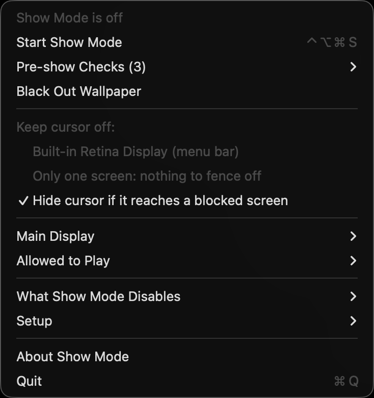

# Show Mode

> **AI-assisted project.** This codebase was created with [Claude](https://claude.com/claude-code)
> (Anthropic), directed and reviewed by a human author.

A menu-bar app for the Mac that's running your slides or playback. It stops the Mac doing
anything clever during the show (going to sleep, popping up notifications, flinging Mission
Control onto the projector, letting the cursor wander onto the LED wall), then puts every
setting back how you had it.

**⌃⌥⌘S** starts/ends show mode · **⌃⌥⌘F** pauses the cursor fence (to reach a show screen deliberately)

> **Field proven.** It's been used on real events, not just on my desk. On macOS 26.4 I've also
> run the power, screen saver, hot corner, Mission Control, True Tone and Night Shift guards and
> every restore path end to end, and the cursor fence (with and without Accessibility), the
> display lock, Do Not Disturb and appearance pinning on a real two-screen setup. Not tried yet:
> the display lock with AirPlay, Sidecar or DisplayLink screens. v0.4.0's privacy dots and swipe
> between Spaces guards haven't done a show yet, and v0.5.0's new guards (system sounds, muting
> other apps, background work, interruptions, remote sessions) have only been checked on the
> bench. All the details are in the [user guide](docs/USER-GUIDE.md).



<!-- downloads:start -->

## Download

**[v0.5.0](https://github.com/stoatworks-labs/showmode/releases/tag/v0.5.0)** — prebuilt for macOS. Pick your platform:

<details>
<summary><b>macOS</b> — Universal (Apple Silicon + Intel)</summary>

| Build | Download | Size |
| --- | --- | --- |
| Universal (Apple Silicon + Intel) · .dmg disk image | [`showmode-0.5.0-macos-universal.dmg`](https://github.com/stoatworks-labs/showmode/releases/download/v0.5.0/showmode-0.5.0-macos-universal.dmg) | 831 KB |

</details>

All builds, checksums and release notes: [github.com/stoatworks-labs/showmode/releases](https://github.com/stoatworks-labs/showmode/releases).

macOS builds are signed and notarised by Apple, so they open normally — no Gatekeeper warning and no quarantine step.

<!-- downloads:end -->

| Guard | How |
|---|---|
| Display & system idle sleep | IOKit power assertions (die with the process) |
| Lid-close sleep *(off by default)* | `pmset disablesleep 1` — admin prompt |
| Low Power Mode | `pmset <source> powermode/lowpowermode 0`, per power source — admin prompt, only if it is on |
| Fans *(off by default, Apple silicon)* | every fan fixed at its maximum (full speed) or minimum (quiet) through the SMC: mode key `F0Md` to 1 and target `F0Tg` to `F0Mx` or `F0Mn`, with the test flag `Ftst` set first where the SMC asks for it (M1–M4). Writing needs root, so a root helper holds them for the show — Show Mode's own executable, run from a copy of the bundle in a root-only directory once `codesign` has checked the copy against the running app's designated requirement. It hands the fans back to macOS at the end or as soon as Show Mode goes away. Quiet hands them back while macOS reports the Mac hot enough to slow down (`thermalState` serious) and takes them again after five cool minutes. Left alone if another app already has them — admin prompt |
| Screen saver | `com.apple.screensaver idleTime 0` (current host) |
| Hot corners | all four `wvous-*` set to no-op, Dock restarted |
| Mission Control / App Exposé / gestures | `mcx-expose-disabled`, the four Dock gesture keys, Dock restarted |
| Swipe between Spaces | `Trackpad{Three,Four}FingerHorizSwipeGesture` and the Magic Mouse's `MouseTwoFingerHorizSwipeGesture`, only where set to swipe between full-screen apps (2 → 0), then `activateSettings -u` so the trackpad driver rereads them; swipe between pages is left alone |
| Click wallpaper to show desktop | `com.apple.WindowManager EnableStandardClickToShowDesktop` |
| Desktop wallpaper | black on every screen (and any plugged in mid-show); the WallpaperAgent store is copied and put back, so dynamic/aerial wallpapers and every Space return exactly |
| Notifications | Do Not Disturb via two generated Shortcuts (see below) |
| System sounds | alert volume and "Play user interface sound effects" to 0 through AudioServices (`ssvl`, `uion`), the calls System Settings' Sound pane makes, and `com.apple.sound.beep.feedback` to 0 (an integer: loginwindow plays the pop and reads it as one); only where on, restored after. Output volume, mute and app audio are untouched |
| Other apps' sound *(off by default, macOS 26+)* | one private global Core Audio process tap (`muteBehavior = .muted`) mutes every app except those ticked under **Allowed to Play**, excluded by bundle ID (`CATapDescription.bundleIDs`) so one opened mid-show is simply heard; their helpers (`com.google.Chrome.helper`) count. Nothing reads the tap: no recording permission, no privacy dot. Measured by recording a loopback output: the mute takes hold of each sound as it starts, and a sound already playing when the show starts carries on until it stops, so the start-of-show note names those apps. It dies with Show Mode, so a crash brings sound back rather than silencing the show |
| Night Shift | CoreBrightness `CBBlueLightClient` — disabled *and* its schedule cleared |
| True Tone | CoreBrightness `CBTrueToneClient` |
| Auto light/dark appearance | SkyLight `SLSSetAppearanceThemeSwitchesAutomatically(false)` pins the showing appearance, the same call System Settings makes (the preference key alone changes nothing live); restored after |
| Colour-shift apps | quits f.lux, Shifty, Lunar; relaunches them after |
| Cursor fence | keeps the cursor off the screens you tick |
| Display arrangement | keeps the chosen (or starting) main display main, and splits any screen that starts mirroring mid-show back to extended |
| Privacy dots | SkyLight `SLSSetSuppressPrivacyIndicatorOnExternalDisplays(true)`, the Privacy Indicators switch; only once the Recovery-only `system-override suppress-sw-camera-indication-on-external-displays=on` is set, and only on full-screen external displays (macOS rule). Restored after |
| Stage Manager | `com.apple.WindowManager GloballyEnabled` off, WindowManager restarted |
| ⌘Space | Spotlight's shortcuts (64 ⌘Space, 65 ⌥⌘Space) off in WindowServer through SkyLight `CGSSetSymbolicHotKeyEnabled`, which is not saved, so a restart mid-show brings them back anyway |
| Crash reports | `com.apple.CrashReporter UseUNC`: "quit unexpectedly" goes to Notification Center, where Do Not Disturb holds it, instead of a window. The report is still written |
| AirPlay Receiver | `-currentHost com.apple.controlcenter AirplayReceiverEnabled` off, which Control Center applies at once (macOS 26 spells it correctly; the older misspelling `AirplayRecieverEnabled` is written too). Frees TCP 5000/7000 and stops another device taking over the screen |
| Keyboard Setup Assistant | quit whenever it opens mid-show (a clicker or keypad that presents as a keyboard). Nothing to restore |
| Photo & media analysis | `photoanalysisd` and `mediaanalysisd` paused (SIGSTOP) by a sweeper, resumed (SIGCONT) at the end or as soon as Show Mode goes away. See [Background work](#background-work) |
| App update checks | `SUEnableAutomaticChecks` off in each running Sparkle app's own defaults (Sparkle 2 watches the key while it runs); Microsoft AutoUpdate `HowToCheck` set to `Manual` unless the organisation manages it. Restored after |
| Syncthing | every folder that is syncing paused through Syncthing's local REST API (`PATCH /rest/config/folders/<id>`, key from its `config.xml`); only those are resumed |
| Sync apps | quits Resilio Sync, Synology Drive, MEGA, Sync.com and Box Drive, and opens them again after. Several sync through File Provider, which may carry on after the app quits |
| Time Machine *(off by default)* | `tmutil stopbackup` and `tmutil disable` — admin prompt, only if automatic backups are on. Read back after: without Full Disk Access `tmutil` reports success and changes nothing |
| Spotlight indexing *(off by default)* | Spotlight's importers (`mdworker_shared`, `mdworker`) paused by a root sweeper started from the admin prompt; `mds` and `mds_stores` keep running and answering searches |
| Automatic updates *(off by default)* | `AutomaticDownload` and `AutomaticallyInstallMacOSUpdates` (`com.apple.SoftwareUpdate`) and the App Store's `AutoUpdate` (`com.apple.commerce`) off — admin prompt; left alone on a managed Mac. Security responses and XProtect data are not touched |
| Remote sessions | every 5 s: inbound connections on 5900, 3283, 4000 and 7070 and TeamViewer's session process name the session in the menu and the log; the black wallpaper is put back if anything changed it |
| AWDL *(expert, off by default)* | `ifconfig awdl0 down`, held down by the root sweeper (macOS raises it again on its own). Costs AirDrop, peer-to-peer AirPlay, Sidecar and Universal Control |
| Look in use *(experimental, off)* | `IOPMAssertionDeclareUserActivity` every four minutes, so the untouched Mac is not taken for idle |
| Game Mode *(experimental, off)* | Xcode's `gamepolicyctl game-mode set on`, and the previous policy put back. Needs Xcode itself |

## Cursor fence

Tick the show screens under **Keep cursor off**. With Accessibility granted, an event tap
rewrites any mouse move that would land on one so it ends up at the nearest point on a screen
you're allowed, and the cursor never gets in. Without Accessibility, a 120 Hz poll warps it
back, and the cursor is hidden while it's near a blocked screen so nobody sees it cross. The
menu won't let you block the last unblocked screen (so a single-display Mac can't be fenced at
all), and it asks before you block the main display, the one with the menu bar and Dock. If
every screen somehow still ends up blocked, or the only allowed one gets unplugged, the fence
stands down rather than trap the cursor somewhere you can't reach it.

Screens are remembered by vendor, model and serial, so your choice survives replugging and
reboots.

## Display arrangement

The main display is made main by moving it to the origin of the global display space
(`CGConfigureDisplayOrigin`, every display shifted by the same amount, so the arrangement is
kept). A reconfiguration callback, debounced by a second, re-applies it and splits new mirrors
(`CGConfigureDisplayMirrorOfDisplay(…, kCGNullDirectDisplay)`); displays already mirrored at
start are left alone. If it has to put things right four times in twenty seconds it gives
up, on the basis that something else clearly wants the displays more than it does. The
previous main display is journalled and restored. Activity goes to `~/Library/Logs/ShowMode.log`.

## Privacy dots

No app can hide the microphone, camera and screen-recording dots, so Show Mode tells you
about them instead.
WindowServer draws each dot as a window named `StatusIndicator` (readable without Screen
Recording access), which gives the screens showing one; CoreAudio process objects
(`kAudioProcessPropertyIsRunningInput`, macOS 14.2+) name the app on the microphone, and
CoreMediaIO says whether a camera is running. If neither, it is screen recording. The Recovery
override is read with `/usr/bin/system-override <key>`, which needs no root outside Recovery.
See the [user guide](docs/USER-GUIDE.md#privacy-dots) for the one-time setup.

## Background work

A show Mac left alone for hours looks idle, and idle is exactly when macOS and every other
app decide it's time for a spot of housekeeping. Processes that can only be paused, never
switched off, go to a
**sweeper**: a small shell loop that sends SIGSTOP to every process with one of a few exact names
every two seconds (so copies launchd starts mid-show are caught), and SIGCONT to them all when the
show ends. It learns that Show Mode has gone — crash and `kill -9` included — from its end of a
pipe closing, never from a pid, and it gives up after three days regardless. The user-level
sweeper (media analysis) is Show Mode's child. Spotlight's `_spotlight` workers and AWDL need
root, so that sweeper starts from the show's one admin prompt, listens on a FIFO Show Mode holds
open, and has its script passed inline rather than from a file anyone could rewrite. At the end
Show Mode reads back what it paused and asks root to resume anything still paused.

What I leave alone on purpose: `mds` and `mds_stores` (stopping them hangs every search),
`trustd`, `mobileassetd`, `softwareupdated`, XProtect and the iCloud daemons, real-time
protection in any antivirus, `launchctl` on Apple services (SIP refuses it, or it does not stick),
and Apple Intelligence (turning it off can delete its models and download them again).

## Pre-show checks

Some things no app can safely switch off, so **Pre-show Checks** lists them, each with the one
thing you need to do: a macOS update waiting (someone choosing *Install Tonight* restarts the
Mac overnight, which is a lovely surprise at call time), updates or Microsoft AutoUpdate managed by an organisation, Dropbox, Google Drive
and OneDrive running (they can only be paused from their own menus; Dropbox keeps syncing after
it quits), backup apps with schedules (Arq, Carbon Copy Cloner, Backblaze, ChronoSync), security
software that opens its own windows or scans on a schedule (Intego, Sophos, Trend Micro, Norton,
LuLu, BlockBlock, Defender, and IT-managed EDR, which is never touched), an active remote session,
a display blacked out by a remote-access privacy mode, the Mac running hot, running on battery,
and a network on Wi-Fi. The ones that can change mid-show stay at the top of the menu while it
runs.

## Notifications

macOS doesn't let apps switch Focus, so Show Mode cheats. **Setup → Install Do Not Disturb
shortcuts** makes and signs two Shortcuts, "Show Mode Focus On/Off" (one *Set Focus* action
each), and Shortcuts asks you to add them once. After that Show Mode runs them with
`shortcuts run`.

## Restoring

Every change goes in a journal (`~/Library/Application Support/ShowMode/journal.plist`)
*before* it's made, along with the value it replaced, and restoring only undoes what Show Mode
changed. Ending show mode, quitting, SIGTERM/SIGINT/SIGHUP and relaunching after a crash all
restore.

Everything that needs root shares one password prompt at the start and one at the end, and
each command runs whatever happened to the one before it. Cancelling the prompt at the start
changes nothing. A command that fails keeps its journal entry, so the end writes the original
back. At the end, anything whose command fails or whose prompt gets cancelled stays in the
journal, the menu offers **Finish Restoring**, and the next launch has another go. Syncthing
folders that couldn't be resumed (because Syncthing wasn't running yet at login) get retried
the same way.

## Automation

`open showmode://on` · `off` · `toggle` · `fence-on` · `fence-off` · `wallpaper-black` ·
`wallpaper-restore` — e.g. from Companion or a
show-control script. `ShowMode --status` prints what it can see without changing anything.

## Build

```bash
scripts/build-app.sh
```

That builds a universal `dist/Show Mode.app`, Developer ID-signed if that identity is in the
keychain (a stable signature means the Accessibility grant survives rebuilds).
